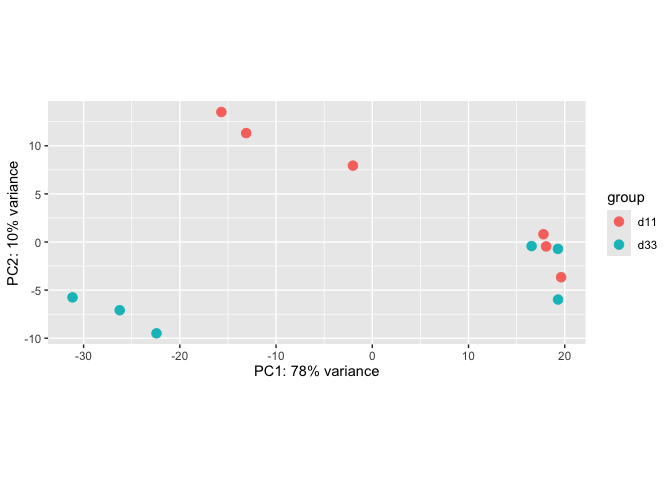
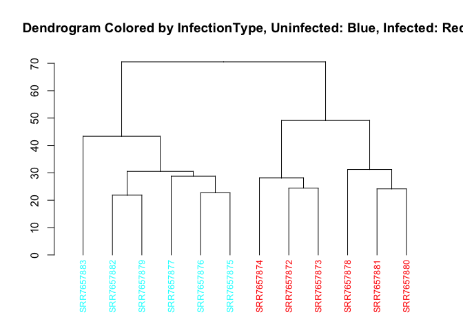
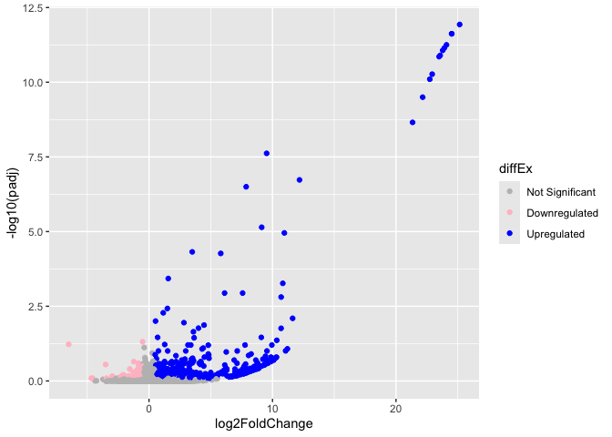

# BulkRNASeq
Sneha Gorla
2026-08-10

- [🧬 1. Objective](#dna-1-objective)
- [📦 2. Setup and Library
  Activation](#package-2-setup-and-library-activation)
- [📥 3. Data Import and Metadata
  Alignment](#inbox_tray-3-data-import-and-metadata-alignment)
- [🛠️ 4. Constructing the DESeq2
  Object](#hammer_and_wrench-4-constructing-the-deseq2-object)
- [📊 5. Principal Component Analysis + PCA
  Plot](#bar_chart-5-principal-component-analysis--pca-plot)
- [📊 6. Visualization](#bar_chart-6-visualization)

## 🧬 1. Objective

Objective: learning the basic pipeline for using the DESeq library and
finding the DEGs from the data set.

Mentor: [Shaina
Tran](https://www.linkedin.com/in/shaina-tran-5323aa128/?isSelfProfile=false),
Bioinformatics Programmer, Neil C. Chi Lab

Referenced the following tutorial: [DESeq2
Tutorial](https://bioconductor.org/packages/devel/bioc/vignettes/DESeq2/inst/doc/DESeq2.html)

------------------------------------------------------------------------

## 📦 2. Setup and Library Activation

We begin by loading the required libraries for the DE and the plots.

``` r
library(dplyr)
library(ggplot2)
library(here)
library("DESeq2")
library("pcaExplorer")
library(dendextend)
library("pheatmap")
library("RColorBrewer")
library("ggrepel")
```

------------------------------------------------------------------------

## 📥 3. Data Import and Metadata Alignment

Reading in both of the data sets. Adjusting the formatting of the
Metadata so it can be properly aligned with the counts data. Creating a
new column based on the replicate number and the infection type so they
can be used as variables in the later DE.

``` r
#read in data
sampleMetadata <- read.delim("Desktop/ChiLab/bulkRNA/samplesheet.tsv", header = TRUE)
countsData <- read.delim("Desktop/ChiLab/bulkRNA/counts.txt", header = TRUE)

#adding in columns for replicate and infection type as well as turning each sample name into its corresponding row name for the later alignment
colIntoList <- as.list(sampleMetadata$Replicate)
infectionStatus <- list()
names(countsData)[1] <- "geneIdentifier"

sampleMetadata <- sampleMetadata %>% mutate(infectionType = 0)

rows <- nrow(sampleMetadata)
rowName <- list()

for(j in 1:rows){
  sampleMetadata[j,"infectionType"] <- strsplit(sampleMetadata[j,1],"_")[[1]][2]
  rownames(sampleMetadata)[j] <- strsplit(sampleMetadata[j,1],"_")[[1]][1]
  sampleMetadata[j,"SampleName"] <- strsplit(sampleMetadata[j,1],"_")[[1]][1]
}

sampleMetadata$SampleName <- NULL

for(i in 1:rows){
  if(grepl("1",colIntoList[i])){
    colIntoList[i]= "1"
  }
  if(grepl("2",colIntoList[i])){
    colIntoList[i] = "2"
  }
  if(grepl("3",colIntoList[i])){
    colIntoList[i] = "3"
  }
}
sampleMetadata <- sampleMetadata %>% mutate(replicateAdjusted = colIntoList)
sampleMetadata$Replicate <- NULL
sampleMetadata["SRR7657873","infectionType"] <- "Infected"
sampleMetadata["SRR7657882","infectionType"] <- "Uninfected"

infectedDF <- subset(sampleMetadata, infectionType == "Infected")
countsDataInfected <- countsData[, (names(countsData) %in% rownames(infectedDF)), drop = FALSE]
countsDataInfected$geneIdentifier <- countsData$geneIdentifier
countsDataInfected <- countsDataInfected %>% relocate(geneIdentifier)

infectedDF$replicateAdjusted <- as.factor(unlist(infectedDF$replicateAdjusted))

rownames(countsData) <- countsData$geneIdentifier
countsData$geneIdentifier <- NULL
sampleMetadata$replicateAdjusted <- factor(
  as.character(sampleMetadata$replicateAdjusted)
)
```

------------------------------------------------------------------------

## 🛠️ 4. Constructing the DESeq2 Object

Using the adjusted metadata and original count data, I am now using the
DESeq library to create the DESeq object and obtain results from the DE.

``` r
dds <- DESeqDataSetFromMatrix(countData = countsData,
                              colData = sampleMetadata,
                              design = ~TimePoint)
#DE is run on the data set
dds <- DESeq(dds)
res <- results(dds,contrast=c("TimePoint", "d33", "d11"))
summary(res)
```


    out of 24082 with nonzero total read count
    adjusted p-value < 0.1
    LFC > 0 (up)       : 52, 0.22%
    LFC < 0 (down)     : 3, 0.012%
    outliers [1]       : 57, 0.24%
    low counts [2]     : 2727, 11%
    (mean count < 0)
    [1] see 'cooksCutoff' argument of ?results
    [2] see 'independentFiltering' argument of ?results

``` r
resDF <- as.data.frame(res)
```

------------------------------------------------------------------------

## 📊 5. Principal Component Analysis + PCA Plot

Here, the Principal Component Analysis is plotted. The PCs capture the
largest to smallest sources of variation in the data, condensing large
data sets and trends.

``` r
vsd <- vst(dds)
#creates a pca plot based on time point (variable can be changed)
pca_plot <- plotPCA(vsd, intgroup="TimePoint")
pca_plot
```



------------------------------------------------------------------------

## 📊 6. Visualization

In order to visualize the results from the analysis, two plots are made,
a dendrogram and a volcano plot. The dendrogram is a heirarchical
structure that shows relationships between samples inputted into the
pipeline. The volcano plot shows the DEGs that came out of the analysis,
plotting upregulated, downregulated, and insignificant genes.

``` r
vsd <- vst(dds)
sampleDists <- dist(t(assay(vsd)))
hc <- hclust(sampleDists, method = "complete")

#------------------------------------
#Denrogram colored by Infection Type (coloring can be adjusted based on variable)
dend <- as.dendrogram(hc)

metadata_vector <- as.factor(sampleMetadata$infectionType)
metadata_vector
```

     [1] Infected   Infected   Infected   Infected   Uninfected Infected  
     [7] Uninfected Uninfected Uninfected Uninfected Infected   Uninfected
    Levels: Infected Uninfected

``` r
colors_vector <- rainbow(length(levels(metadata_vector))) 
colors_vector
```

    [1] "#FF0000" "#00FFFF"

``` r
label_colors <- colors_vector[metadata_vector]
label_colors <- label_colors[order.dendrogram(dend)]
dend %>%
  set("labels_col", label_colors) %>%
  set("labels_cex", 0.8) %>%  # Adjust label size
  plot(main = "Dendrogram Colored by InfectionType, Uninfected: Blue, Infected: Red")
```



``` r
#------------------------------------
#mutating the results data frame to include up/ down regulated genes based on the below criteria for significance
resDF <- resDF %>% mutate(diffEx = 0)
resDF$diffEx[resDF$log2FoldChange > 0.5 & resDF$pvalue < 0.05] <- "up"
resDF$diffEx[resDF$log2FoldChange < -0.5 & resDF$pvalue < 0.05] <- "down"

#create the volcano plot
ggplot(data = resDF, aes(x = log2FoldChange, y = -log10(padj), col = diffEx)) +
  geom_point() +
  scale_color_manual(values = c("grey", "pink", "blue"),
                     labels = c("Not Significant", "Downregulated", "Upregulated"))
```


