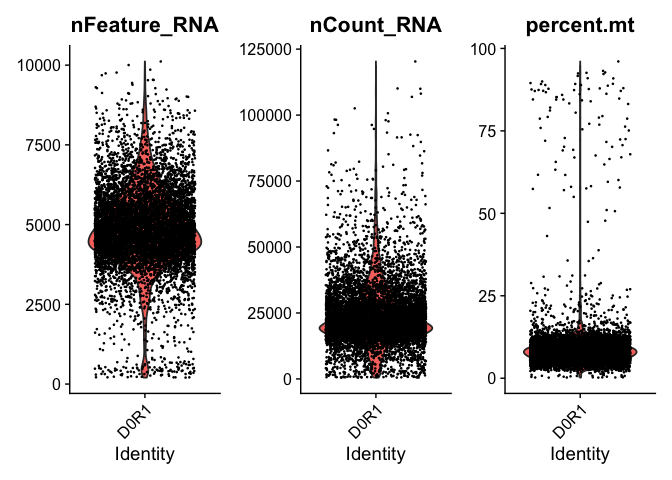
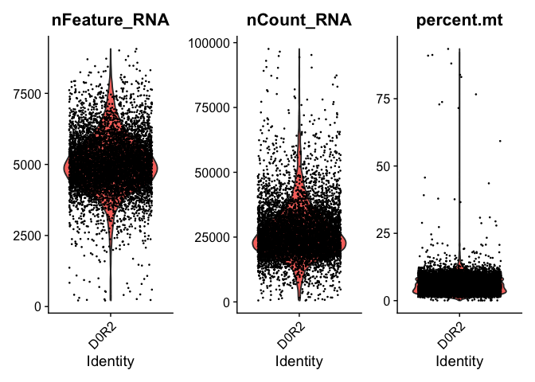
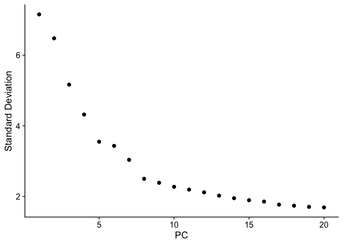
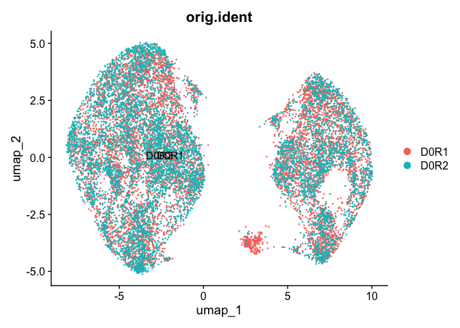

# SingleCellRNASeqWithIntegration
Sneha Gorla
2026-08-10

- [🧬 1. Objective](#dna-1-objective)
- [📦 2. Setup and Library
  Activation](#package-2-setup-and-library-activation)
- [📥 3. Read in 10x Files](#inbox_tray-3-read-in-10x-files)
- [🛠️ 4. Construct the Seurat Object & Initial
  QC](#hammer_and_wrench-4-construct-the-seurat-object--initial-qc)
- [📊 5. Further QC](#bar_chart-5-further-qc)
- [📊 6. Normalization](#bar_chart-6-normalization)
- [🛠️ 7. Find highly variable
  genes](#hammer_and_wrench-7-find-highly-variable-genes)
- [🛠8. Integrate data](#8-integrate-data)
- [🛠9. Scale Data](#9-scale-data)
- [🛠10. Principal Component Analysis](#10-principal-component-analysis)
- [🛠️ 11. Elbow Plot](#hammer_and_wrench-11-elbow-plot)
- [🛠️ 12. Find Neighbors](#hammer_and_wrench-12-find-neighbors)
- [🛠️ 13. Find Clusters](#hammer_and_wrench-13-find-clusters)
- [🛠️ 14. Visualization](#hammer_and_wrench-14-visualization)

## 🧬 1. Objective

Objective: learn the steps to go through the basic single cell RNA
sequencing pipeline.

Mentor: [Shaina
Tran](https://www.linkedin.com/in/shaina-tran-5323aa128/?isSelfProfile=false),
Bioinformatics Programmer, Neil C. Chi Lab

Referenced the following tutorial:
<https://satijalab.org/seurat/articles/integration_introduction>

## 📦 2. Setup and Library Activation

We begin by loading the required libraries for the DE and the plots.

``` r
library(dplyr)
library(Seurat)
```

------------------------------------------------------------------------

## 📥 3. Read in 10x Files

The data sets needed are the barcodes, features, and the matrix which
compose count matrix. These three files are stored in a single folder.

``` r
D0R1 <- Read10X(data.dir = "Desktop/ChiLab/SingleRNAData/D0R1_filtered_gene_bc_matrices")
D0R2 <- Read10X(data.dir = "Desktop/ChiLab/SingleRNAData/D0R2_filtered_gene_bc_matrices")
```

------------------------------------------------------------------------

## 🛠️ 4. Construct the Seurat Object & Initial QC

Using the counts matrix just created from the three files, create a
Seurat object that is quality controlled, removing genes that are
expressed in less than three cells and cells that express less than 200
genes.

``` r
D0R1obj <- CreateSeuratObject(counts = D0R1, min.cells = 3, min.features = 200, project = "D0R1")
D0R2obj <- CreateSeuratObject(counts = D0R2, min.cells = 3, min.features = 200, project = "D0R2")
```

------------------------------------------------------------------------

## 📊 5. Further QC

In order to do further QC, each cell is checked for percentage of
mitochondrial genes expressed, total number of unique genes that a cell
expresses, and the total number of unique molecular identifiers in the
cells. By plotting these values in a violin plot, you can see where most
of the data lies, and remove any outliers through the subset method.

``` r
D0R1obj[["percent.mt"]] <- PercentageFeatureSet(D0R1obj, pattern = "^MT-")
D0R2obj[["percent.mt"]] <- PercentageFeatureSet(D0R2obj, pattern = "^MT-")


#creates 3 violin plots of the data for different variables
VlnPlot(D0R1obj, features = c("nFeature_RNA", "nCount_RNA", "percent.mt"), ncol = 3)
```



``` r
VlnPlot(D0R2obj, features = c("nFeature_RNA", "nCount_RNA", "percent.mt"), ncol = 3)
```



``` r
#creates a subset of the data based on cutoffs determined through the violin
#plots
D0R1obj <- subset(D0R1obj, subset = nFeature_RNA > 1250 & nFeature_RNA < 8750 & nCount_RNA < 75000 & percent.mt < 25)
D0R2obj <- subset(D0R2obj, subset = nFeature_RNA > 2500 & nFeature_RNA < 7500 & nCount_RNA < 75000 & percent.mt < 20)
```

------------------------------------------------------------------------

## 📊 6. Normalization

Then, normalize data through a log transformation so the data can be
correctly scaled.

``` r
D0R1obj <- NormalizeData(D0R1obj)
D0R2obj <- NormalizeData(D0R2obj)
```

------------------------------------------------------------------------

## 🛠️ 7. Find highly variable genes

This step identifies the genes that have highly different expression
between cells, which is one step in differentiating cell types within
the sample.

``` r
D0R1obj <- FindVariableFeatures(D0R1obj, selection.method = "vst", nfeatures = 2000)
D0R2obj <- FindVariableFeatures(D0R2obj, selection.method = "vst", nfeatures = 2000)
```

------------------------------------------------------------------------

## 🛠8. Integrate data

Integrating the two samples using this method in the Seurat library,
combines batches/ samples and allows for their clustering together
without losing any variation that makes the samples distinct.

``` r
obj.list <- list(D0R1obj, D0R2obj)

anchors <- FindIntegrationAnchors(object.list = obj.list)

integrated <- IntegrateData(anchorset = anchors)
```

------------------------------------------------------------------------

## 🛠9. Scale Data

Scaling the data shows cells that have higher than average, lower than
average, or average expression of a gene.

``` r
integrated <- ScaleData(integrated)
```

------------------------------------------------------------------------

## 🛠10. Principal Component Analysis

Here, the Principal Component Analysis is plotted. The PCs capture the
largest to smallest sources of variation in the data, condensing large
data sets and trends.

``` r
integrated <- RunPCA(integrated, features = VariableFeatures(object = integrated))
```

------------------------------------------------------------------------

## 🛠️ 11. Elbow Plot

The elbow plot graphs the PC’s to see where the sources of variation are
no longer significant, so the dimensions could be determined later. The
“elbow” or where the plot begins to flatten is when the sources of
variation are no longer significant and can be ignored in future steps.

``` r
ElbowPlot(integrated)
```



------------------------------------------------------------------------

## 🛠️ 12. Find Neighbors

The FindNeighbors method finds cells (neighbors) that have similar PC
values, and are then likely to be part of the same cluster/ cell type.
The dimensions determine how many PC’s are kept in the comparison, here
I kept all 20 as the elbow plot did not necessarily “flatten” and the
sources of variation still seemed to be significant.

``` r
integrated <- FindNeighbors(integrated, dims = 1:20)
```

------------------------------------------------------------------------

## 🛠️ 13. Find Clusters

Using the network graph produced from Find Neighbors, Find Clusters now
clusters the cells together, indicating which cells are part of the same
cell type.

``` r
integrated <- FindClusters(integrated, resolution = 0.5)
```

    Modularity Optimizer version 1.3.0 by Ludo Waltman and Nees Jan van Eck

    Number of nodes: 14525
    Number of edges: 541565

    Running Louvain algorithm...
    Maximum modularity in 10 random starts: 0.8754
    Number of communities: 11
    Elapsed time: 2 seconds

------------------------------------------------------------------------

## 🛠️ 14. Visualization

UMAP uses the clusters created in Find Clusters, and allows us to
visualize the clusters of cells. The UMAP does not actually perform any
clustering, it just helps to visualize the already created clusters.

``` r
integrated <- RunUMAP(integrated, dims = 1:20)
DimPlot(integrated, reduction = "umap", label = TRUE, group.by = "orig.ident")
```



------------------------------------------------------------------------
